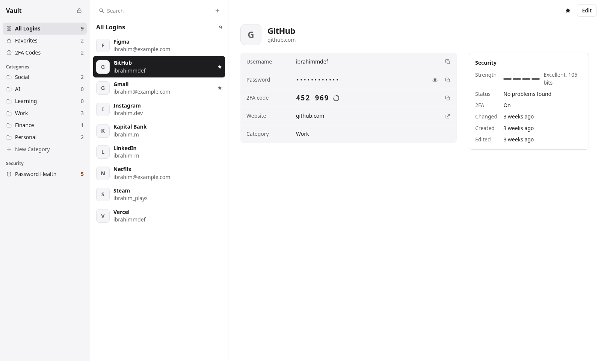
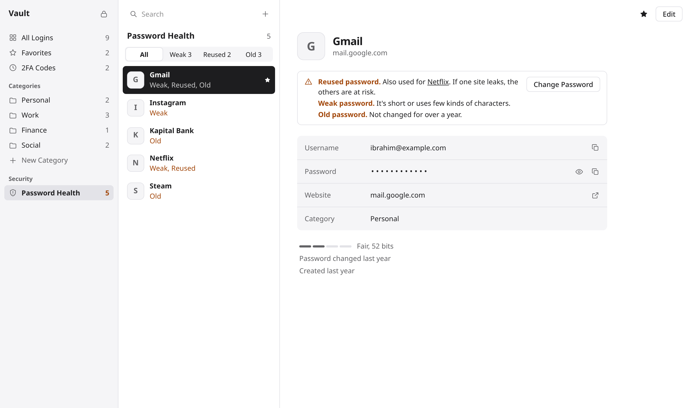
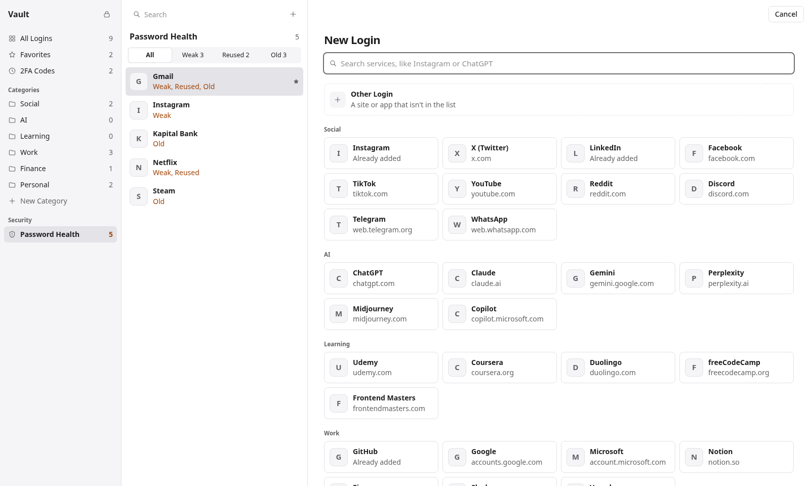
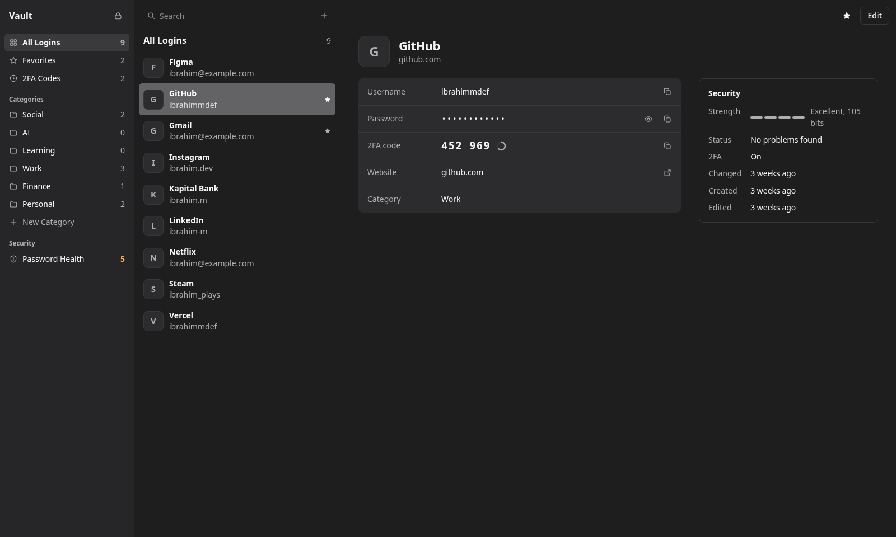
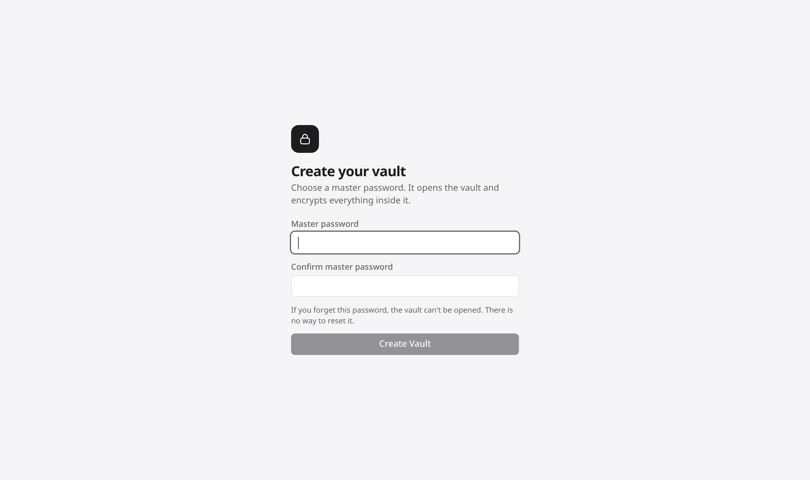

# Vault

A desktop password manager built with **React, Tailwind CSS and Electron**. Your logins are kept in one encrypted file on your computer, protected by a master password that is never stored.



## Download

Get the latest version from the [Releases page](https://github.com/ibrahimmdef/password-generator/releases/latest):

| System | File | How to run |
| --- | --- | --- |
| Windows | `Vault-1.0.0-windows-x64.zip` | Unzip and open `Vault.exe` |
| Linux | `Vault-1.0.0-linux-x64.zip` | Unzip and run `Vault` |

The app isn't code-signed yet, so Windows may show a SmartScreen warning. Choose **More info → Run anyway**.

Your vault is saved in `%APPDATA%\Vault` on Windows and `~/.config/Vault` on Linux.

## Features

- **Encrypted vault.** AES-256-GCM, with a key derived from your master password using PBKDF2-SHA256 at 600,000 iterations. The master password and decrypted data never touch the disk.
- **Logins with categories and favorites**, plus search across titles, usernames and websites.
- **Ready-made services.** Pick Instagram, ChatGPT, GitHub and 29 more from a searchable catalog, and the title, website and category are filled in for you.
- **2FA codes.** Add a site's setup key (or `otpauth://` link) and the app shows the live 6-digit code with a countdown, like an authenticator app.
- **Password health.** Finds weak passwords, passwords reused across sites, and passwords not changed for over a year.
- **Password generator** built into the login form, using `crypto.getRandomValues` with rejection sampling so every character is equally likely.
- **Safe by default.** Auto-locks after 5 minutes without activity, and clears copied passwords from the clipboard after 30 seconds.
- **Desktop-first design.** Three-pane layout, keyboard shortcuts, light and dark mode, screen reader labels.

| Password health | Ready-made services |
| --- | --- |
|  |  |
| **Dark mode** | **Lock screen** |
|  |  |

## Keyboard shortcuts

| Shortcut | Action |
| --- | --- |
| `Ctrl/Cmd + F` | Search |
| `Ctrl/Cmd + N` | New login |
| `Ctrl/Cmd + L` | Lock the vault |
| `↑` `↓` | Move through the list |
| `Esc` | Close the generator or cancel editing |

## Tech stack

| Area | Tools |
| --- | --- |
| UI | React 19, Tailwind CSS 4 |
| State | `useReducer` + Context |
| Crypto | Web Crypto API (PBKDF2, AES-GCM, HMAC-SHA1 for TOTP) |
| Desktop | Electron (sandboxed renderer, `contextBridge` IPC) |
| Build and tests | Vite, Vitest |

## Getting started

```bash
git clone https://github.com/ibrahimmdef/password-generator.git
cd password-generator
npm install
npm run electron        # build and open the desktop app
```

For development in the browser (the vault is kept in `localStorage` there):

```bash
npm run dev
```

| Command | What it does |
| --- | --- |
| `npm run dev` | Start the Vite dev server in the browser |
| `npm run electron` | Build and open the desktop app |
| `npm run electron:dev` | Open Electron against the running dev server |
| `npm test` | Run the unit tests |
| `npm run package:linux` | Package a Linux app into `release/` |
| `npm run package:win` | Package a Windows app into `release/` |

## How it's built

```
src/
├── lib/          Pure logic, no React: crypto, TOTP, password generation,
│                 health checks, filtering, services catalog. Each file has its own tests.
├── state/        vaultReducer (every change to the vault), VaultContext
│                 (useVault hook), storage (file in Electron, localStorage in the browser)
├── hooks/        useNow, useIdle, useShortcuts
├── components/   LockScreen, Vault, Sidebar, LoginList, LoginDetail,
│                 LoginForm, ServicePicker, PasswordGenerator, TotpCode,
│                 ui.jsx (shared pieces)
└── App.jsx       Picks the screen from the vault status
electron/
├── main.cjs      Window and the two file operations (load, save)
└── preload.cjs   Exposes only window.vaultFile to the page
```

The encryption happens in React. Electron's main process only ever receives the already encrypted file, so it never sees a password. Saves are written to a temporary file and then renamed, so a crash can't leave a half-written vault.

## License

ISC
